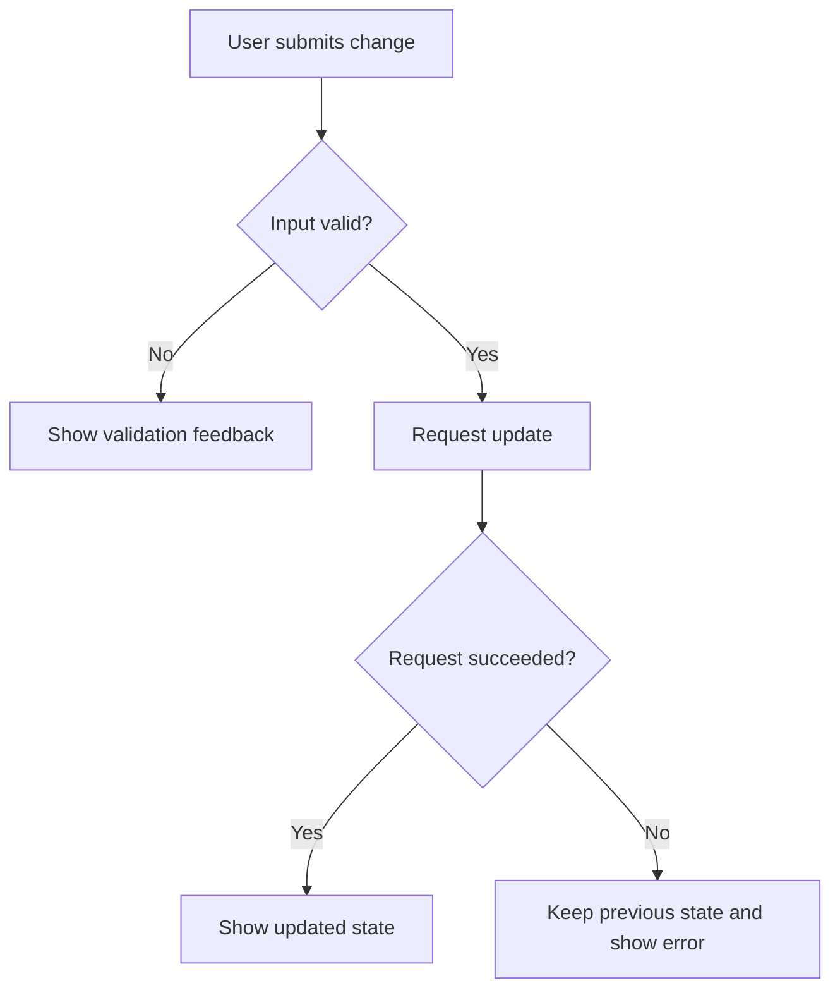

# Logic-flow Diagrams

Default to one diagram for the main changed flow; add another only for a
distinct flow that needs its own explanation.

Before drawing, trace the trigger through actual callers, conditions, side
effects, and terminal outcomes in the compared code. Read surrounding code and
tests where needed. PR summaries and existing bot diagrams are context, not
proof. Every node and arrow must be supported by inspected code; identify gaps
in the caption rather than inventing connections.

- Default to `flowchart TD` for logic; use `LR` for a short pipeline. Use `sequenceDiagram` when the order of interactions between participants is the point.
- Show the changed behavior plus just enough unchanged context to connect it. Label it **After change**; use separate **Before** and **After** diagrams only when the contrast explains the fix and both versions were inspected.
- Start with the user action or system event. Use action boxes, decision diamonds, labeled branches (`Yes` / `No`, `Success` / `Failure`), and explicit outcomes.
- Include relevant failure, fallback, retry, cancellation, and stale-result paths found in code. Distinguish starting async work from receiving and accepting its result; include an ordering check only when the code has one.
- Aim for 5–12 nodes with short, plain-language labels. Split larger flows by responsibility instead of drawing every function or file.
- Put the diagram beside its chapter, followed by a short caption explaining the key change and citing supporting files/functions or line ranges. Keep citations outside node labels.

For GitHub or Mermaid-capable Markdown, use fenced `mermaid` blocks; the host
renders the diagram as SVG. Use simple syntax, stable node IDs, and quoted
labels. Let the host choose its theme. For requested HTML, use inline SVG. If
the destination cannot render diagrams, keep the Mermaid source with a brief
plain-language walkthrough; use ASCII only for explicitly text-only output.
Return diagram content in the response under the host's permissions.

Syntax example only; replace this flow with behavior verified in the diff:

